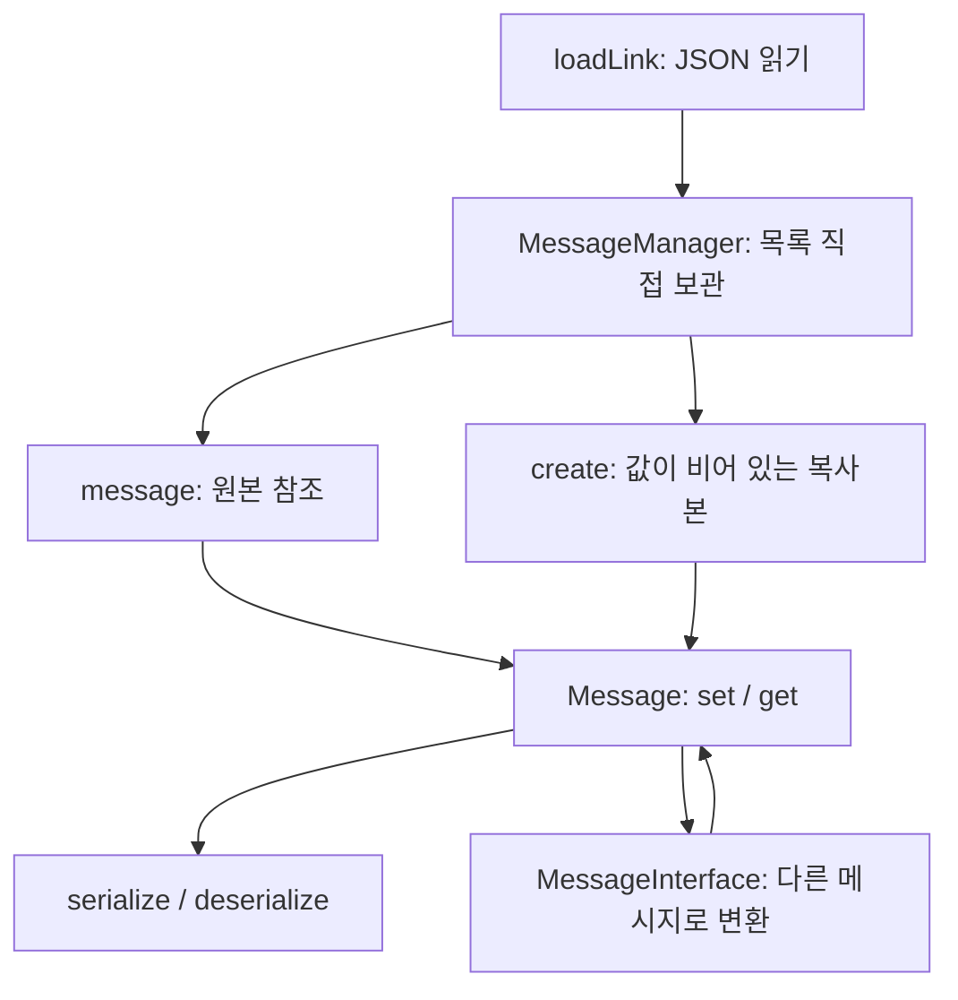
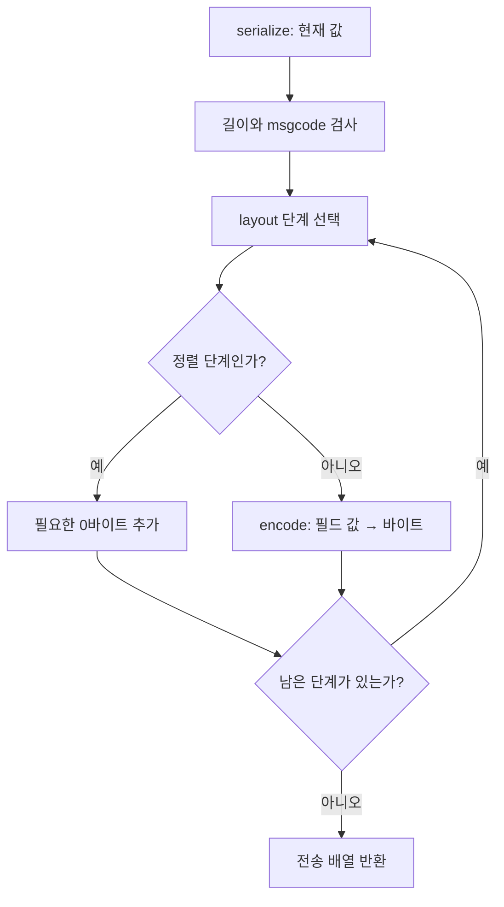

# v17 유지보수 안내 — 어디서 무엇을 하는가

이번 배포본은 v15 실행 코드의 흐름·표준 라이브러리 설명판입니다. SOURCE_READING_GUIDE_KO.md에서 읽는 순서를 확인할 수 있습니다.

## 1. 이번에는 실제 구조를 바꿨습니다

| 항목 | v13 | v14 |
|---|---|---|
| 메시지 관리 경로 | Manager → Catalog → Link → Message | Manager → Message |
| 메시지 관련 주요 클래스 | Manager, Catalog, Link, Message, Interface | Manager, Message, Interface |
| 필드 접근 중간 객체 | FieldAccess | 제거 |
| 값 설정 | 경로 set 또는 여러 [] 접근 | 전체 경로 set 하나로 통일 |
| 관리자가 보관하는 현재 메시지 | 별도 Catalog 정의와 Message 사전 | Manager의 실제 Message 목록 |
| 이름/코드 조회용 사전 | 여러 사전 사이를 이동 | 목록에서 직접 비교 |
| 필드 이름→인덱스 사전 | `_fieldIndexes` | 제거. `_fields`에서 직접 비교 |
| 함수 설명 | 주로 한 줄 요약 | 역할 / 입력 / 반환 / 흐름을 구현 함수 위에 표시 |
| 처리 결과 반환 | 호출을 한 줄로 연결한 경우가 있음 | 핵심 처리를 중간 변수와 문장으로 분리 |

EnumDefinitions는 enum만, DumpTable은 표 출력만 담당하는 작은 보조 클래스입니다.
JSON 중복 키 검사용 작은 객체도 있습니다. 프로젝트의 모든 클래스가 세 개라는 뜻은 아닙니다.
직접 작성한 코드는 message_manager 네임스페이스를 사용합니다.
외부 JSON 라이브러리 third_party/nlohmann/json.hpp는 원본 그대로 사용합니다.

## 2. 전체 그림



코드를 읽을 때는 먼저 examples/simple_main.cpp를 보세요.
그다음 MessageManager.cpp의 loadLink → addLink → message → create 순서로 읽으면 됩니다.
평소 값 설정/수신을 수정할 때는 중간 Catalog/Link 클래스를 따라갈 필요가 없습니다.

## 3. Manager 안에는 무엇이 있나

| 멤버 | 실제 내용 | 사용 목적 |
|---|---|---|
| `_enums` | 공통 enum 정의 | 링크를 읽기 전에 등록 |
| `_links` | LinkInfo 목록: 이름, 코드 경로, 코드 위치 | 수신 코드가 어느 위치에 있는지 확인 |
| `_messages` | 실제 Message 객체 목록 | 이름으로 찾아 바로 수정하거나 생성 |
| `_logHandler` | 일반 함수의 주소 | 잘못된 값 설정 시 로그 출력 |

LinkInfo는 처리 기능이 없는 단순한 데이터 묶음입니다. 예전 MessageLink 클래스를 이름만 바꿔 남긴 것이 아닙니다.
메시지 타입/코드/코드별 이름을 각각 보관하던 여러 사전도 제거했습니다.

메시지 목록은 std::list를 사용합니다. 새 링크를 추가해도 이전에 받아 둔 Message 참조가 유지됩니다.
일반 vector는 요소가 늘 때 기존 주소가 바뀔 수 있어서 여기서는 쓰지 않았습니다.
이름 조회는 목록을 순서대로 비교합니다. 대규모 메시지/필드를 매번 조회하는 경우 기존 사전 조회보다 느릴 수 있습니다.
이번 버전은 이해하기 쉬운 조회 흐름을 우선했습니다. 바이트 변환 자체의 배치 규칙은 바꾸지 않았습니다.

## 4. message와 create 차이

```cpp
message_manager::Message &original = manager.message("link_message1", "message1");
original.set("body.position.x", 10);
```

original은 Manager 안에 보관된 원본의 참조입니다. &가 있으므로 여기서 바꾸면 관리자의 값도 바뀝니다.

```cpp
message_manager::Message fresh = manager.create("link_message1", "message1");
fresh.set("body.position.x", 20);
```

fresh는 정의와 msgcode만 복사한 새 메시지입니다. 원래 설정했던 x=10 등 사용자 데이터는 물려받지 않습니다.
fresh를 바꾸어도 original은 바뀌지 않습니다.

실제 create 함수는 다음 순서입니다.

```cpp
const Message &definition = message(linkName, messageName);
Message result = definition.emptyCopy();
return result;
```

첫 줄에서 찾고, 둘째 줄에서 만들고, 셋째 줄에서 돌려줍니다.
디버거에서 각 중간 변수를 확인할 수 있습니다.

## 5. JSON 등록 순서

loadLink(path): 파일 읽기 → JSON을 definition에 저장 → addLink(definition) → 링크 이름 반환.

addLink의 흐름:

1. 링크 이름과 dispatch 설정을 검사합니다.
2. 이미 등록한 링크 이름인지 확인합니다.
3. 각 메시지를 makeMessage로 만들어 임시 목록 prepared에 넣습니다.
4. 같은 링크의 코드가 중복되지 않고 코드 위치가 같은지 확인합니다.
5. 전체가 성공하면 실제 `_links`, `_messages`에 등록합니다.

중간에 메시지 하나가 잘못되면 실제 목록에 반영하지 않습니다.
실패한 링크 이름으로 정상 정의를 다시 등록할 수도 있습니다.

인라인 구조체는 addInlineType과 inlineMessageType에서 공통 types 모양으로 정리합니다.
이 두 함수는 JSON 정의를 읽을 때만 필요합니다. 일반적인 set/get 과정에서는 호출하지 않습니다.

## 6. Message의 세 가지 핵심 자료

| 멤버 | 내용 | 의미 |
|---|---|---|
| `_fields` | Field 목록: 이름/타입/길이/현재 `_value` | 정의와 현재 값을 한 곳에 보관 |
| `_containers` | 부모 경로 → 자식 경로 목록 | 구조체/배열 전체 set/get |
| `Field::_alignment` | 해당 필드 앞의 정렬 경계 | 현재 버퍼 위치에서 패딩 계산 |
| `_endAlignment` | 마지막 구조체의 끝 정렬 경계 | 메시지 끝 패딩 계산 |

v14의 별도 `_values` 사전은 삭제했습니다.
예를 들어 body.position.x 필드 안에 타입 int16_t, 바이트 수 2, 현재 값 -10이 함께 들어 있습니다.
`_value`가 null이면 아직 사용자가 값을 넣지 않은 상태입니다.
같은 타입의 검사/정렬을 반복하지 않기 위한 보조 캐시 두 개는 유지합니다.

## 7. 값 설정을 따라 읽기

```cpp
msg.set("body.position.x", 10);
```

Message::set은 다음 순서입니다.

1. 입력을 Json input으로 바꿉니다.
2. 현재 Message를 candidate라는 임시 작업본으로 복사합니다.
3. candidate.collectSet이 임시 Field._value에 새 값을 기록합니다.
4. candidate.checkLengths가 지금 확인 가능한 길이를 검사합니다.
5. 성공한 candidate의 필드 목록을 실제 `_fields`에 반영합니다.

실패하면 실제 Message를 바꾸지 않습니다.
복사본의 모든 검사가 성공해야 반영한다는 흐름을 한 문장씩 볼 수 있게 작성했습니다.

```cpp
int x = msg.get<int>("body.position.x");
```

get은 readValue로 JSON 값을 읽고 checkedGet<int>로 범위를 확인해 반환합니다.
checkedGet의 타입별 분기는 작은 정수로 읽을 때 값이 잘리지 않도록 하는 공통 안전장치입니다.
이 함수의 템플릿 내부보다 set/get의 사용 흐름부터 익히시면 됩니다.

## 8. 구조체와 배열

```cpp
msg.set("body.points[0].x", -10);
int x = msg.get<int>("body.points[0].x");
std::size_t points = msg.elementCount("body.points");
```

배열 인덱스도 문자열 경로 안에 적습니다. 예전 FieldAccess 중간 객체는 없습니다.
elementCount는 아직 값을 설정하지 않았어도 정의의 원소 개수를 반환합니다.

구조체/배열 전체를 Json 또는 vector 값으로 설정하는 기능도 유지합니다.

## 9. 가변 버퍼

```cpp
char data[] = {'A', '\0', 'B'};
msg.set("body.data.buffer", data, sizeof(data));
msg.set("body.data.length", sizeof(data));
```

버퍼의 주소를 보관하는 것이 아니라 바이트 내용을 복사합니다.
char*의 length는 사용자가 따로 설정합니다. buffer를 설정했다고 length를 자동 갱신하지 않습니다.
serialize 직전에 두 값이 맞는지 최종 검사합니다.
구형 bytes 타입의 자동 길이 기능은 기존 정의와의 호환을 위해 유지합니다.

## 10. 바이트 변환 흐름



uint16_t 값 0x1234는 big이면 12 34, little이면 34 12로 기록합니다.
비트필드가 앞 필드와 저장 바이트를 공유하면 `_continuation`이 true입니다.
이때는 새 바이트를 늘리지 않고 앞 저장 단위에 해당 비트를 합칩니다.

수신은 반대 순서입니다. `_fields`를 순회하며 필드별 정렬 크기로 패딩을 건너뛴 뒤 decodeScalar로 값을 읽고 임시 Message candidate의 필드에 넣습니다.
수신 코드 검사가 성공해야 임시 메시지의 필드 목록을 실제 `_fields`에 반영합니다.
비트필드/엔디안의 비트 계산은 남아 있지만 encode/decodeScalar 함수에 모아 주석으로 설명했습니다.

## 11. 변환 흐름

MessageInterface::fromFile(path, manager)는 변환 설정을 읽고 대상 생성에 필요한 정의를 복사해 둡니다.
원래 manager가 사라져도 변환기가 잘못된 주소를 참조하지 않습니다.

| 함수 | 역할 |
|---|---|
| readMappingFile | 별도 mapping_file을 인터페이스 파일의 폴더 기준으로 읽음 |
| loadMappingTables | 이름별 공통 매핑표를 읽음 |
| readFieldMapping | 필드 항목 하나를 복사/매핑/상수 중 하나로 분류 |
| loadRules | 원본/대상과 필드 항목들을 규칙으로 보관 |
| mapValue | 값 하나의 from을 찾아 to로 변환 |
| convertInto | 빈 대상 복사본에 처리하고 성공했을 때 실제 대상으로 반영 |

원본 값 읽기, 매핑 값 계산, 대상 값 설정도 세 문장으로 나누었습니다.

```cpp
const Json originalValue = source.value(mapping._sourceField);
const Json mappedValue = mapValue(mapping, originalValue);
converted.set(mapping._targetField, mappedValue);
```

## 12. 십진수와 16진수

| JSON 표기 | 정수 값 |
|---|---:|
| `50` | 50 |
| `"50"` | 50 |
| `"0x32"`, `"0X32"` | 50 |
| `"-50"`, `"-0x32"` | -50 |

JSON 문법상 16진수는 큰따옴표가 필요합니다. 따옴표 없는 0x32는 문법 오류입니다.
앞에 0이 있어도 십진수입니다. "050"은 50입니다.
앞뒤 공백/잘못된 숫자/소수 문자열은 정수로 받지 않습니다.

msgcode, alignment, count, length, max_length, bits, enum 숫자 키, 정수 필드/배열/버퍼,
constants와 mapping 값에 같은 규칙을 적용합니다.
float/double에도 정수 문자열을 지정할 수 있습니다. 문자열 타입 필드는 그대로 보관합니다.
매핑 입력의 숫자 문자열은 숫자와 같게 비교하므로 50과 "0x32"를 중복 정의할 수 없습니다.

## 13. 고정값 지정

```json
{"from":"body.position.y","to":3}
```

대상의 같은 경로 body.position.y를 3으로 설정합니다. 원본 y는 바꾸지 않습니다.
to:"3", to:"0x3"도 같습니다. 원본과 대상의 경로가 다르면 다음과 같이 적습니다.

```json
{"from":"body.position.y","to":"body.coordinates.north","value":"0x3"}
```

고정값과 mapping을 동시에 지정할 수는 없습니다.
같은 대상 필드에 중복으로 쓰는 설정도 거부합니다.
고정값이 대상 타입 범위를 넘으면 기존 대상 값을 유지합니다.
완전한 예제 JSON은 json/integer_formats 폴더에 있습니다.

## 14. 클래스 작성 규칙

public 함수 → protected 함수 → private 내부 자료형/함수 → private 변수 순서입니다.
상속 기능이 없으므로 protected는 비어 있으며 이유를 적었습니다.
멤버변수는 `_abc`, 일반 지역변수는 `abc` 형태입니다.
라이브러리 구현/예제/시험에 람다는 없습니다.
라이브러리 구현에는 auto, optional, std::move를 쓰지 않습니다.

## 15. 이전 호출 변경표

| 이전 | 변경 후 |
|---|---|
| manager.catalog().create(link, name) | manager.create(link, name) |
| fromFile(path, manager.catalog()) | fromFile(path, manager) |
| MessageCatalog 또는 MessageLink | MessageManager |
| msg["body"]["position"]["x"].set(10) | msg.set("body.position.x", 10) |
| msg["body"]["position"]["x"].get<int>() | msg.get<int>("body.position.x") |
| msg["body"]["data"]["buffer"].getBuffer() | msg.getBuffer("body.data.buffer") |
| msg["body"]["points"].size() | msg.elementCount("body.points") |

MessageLink.hpp는 삭제했습니다. MessageManager.hpp를 포함합니다.
변환기를 사용하는 파일에는 MessageInterface.hpp도 포함합니다.
네임스페이스 message_manager와 이전의 JSON 필드 이름은 그대로입니다.
새 헤더와 새 .a로 호출 프로그램을 다시 빌드해야 합니다.

## 16. 빌드와 확인

```bash
make -j4
./build/simple_demo
./build/demo json
make test
```

압축을 푼 binary_message 폴더에서 실행합니다. 정적 라이브러리는 lib/libbinary_message.a입니다.
CMake를 사용하는 환경에서는 다음 설정도 제공합니다.

```bash
cmake -S . -B build-cmake -DCMAKE_BUILD_TYPE=Debug
cmake --build build-cmake -j4
ctest --test-dir build-cmake --output-on-failure
```

기존 실행 검사는 test/verification/v15_review.md, v16 주석 정리 검증은 test/verification/v16_comment_cleanup.md에 정리합니다.
이전 버전 검증 기록은 test/verification/history에 보관합니다.

## 17. v15의 문장별 작성 방식

중첩 호출, return 내부의 변환, 최대/최소와 삼항 선택을 중간 변수와 if로 풀었습니다.
v17은 v15와 같은 실행 코드에 주요 처리 흐름과 컨테이너/문법 설명을 더한 학습용 주석판입니다. 단순 문장 해설을 반복하지 않고 데이터 흐름과 선택 이유를 설명합니다.
자세한 예제는 CODE_STYLE_GUIDE_KO.md에 있습니다. v14에서 사용하던 공개 set/get API와 JSON 형식은 유지합니다.

set은 원본 보존을 위해 임시 Message를 복사합니다. 대량 반복 처리에서는 이 복사 비용도 함께 측정해 주세요.
